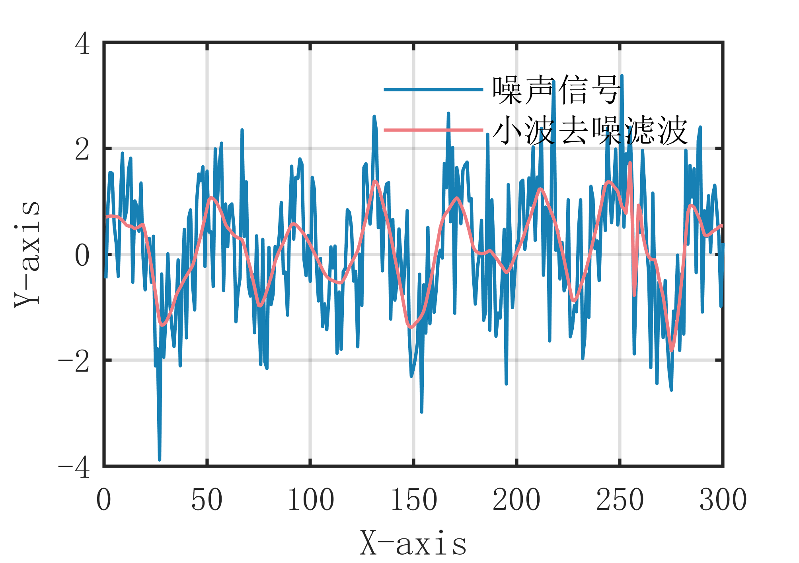

# MATLAB | Digital Signal Processing | Wavelet Denoising Filter Algorithm | Includes data and plotting code | Directly Useable

1. Basic Definition
The wavelet denoising filter algorithm is a filtering method based on wavelet transformation, which decomposes the signal's frequency components through wavelet transformation and removes noise according to the characteristics of the signal by selecting appropriate threshold processing methods. The main idea of this algorithm is to decompose the signal into multiple frequency components, select an appropriate threshold processing method for each frequency component, perform denoising on each frequency component, then synthesize the denoised frequency components to obtain a smoothed signal. Specifically, the steps of the wavelet denoising filter algorithm are as follows:
- Decompose the signal using wavelets to obtain multiple frequency components.
- Apply threshold processing to each frequency component to remove noise.
- Synthesize the denoised frequency components to obtain a smoothed signal. The advantage of the wavelet denoising filter algorithm is that it can effectively remove noise while preserving the overall trend of the signal; however, it requires selecting an appropriate wavelet basis and threshold processing method, otherwise, it may affect the filtering effect. Additionally, the wavelet denoising filter algorithm can well preserve the rapid changes in the signal, making it widely used in some applications where retaining the rapid changes in the signal is necessary.
2. Definition and Outline Effects
The outline effects are as follows:
\n        \n  
Outline video tutorial operation:
\n        \n          \n          \n          \n          \n            To view this video please enable JavaScript, and consider upgrading to a\n            web browser that\n            supports HTML5 video\n

## Images

<!-- PAYMENT_BLOCK -->

## Get this dataset

- Payment link (Stripe): [Buy now](https://buy.stripe.com/3cs8yP7sY87d0vu9AB)
- Payment QR code: 

<!-- /PAYMENT_BLOCK -->
